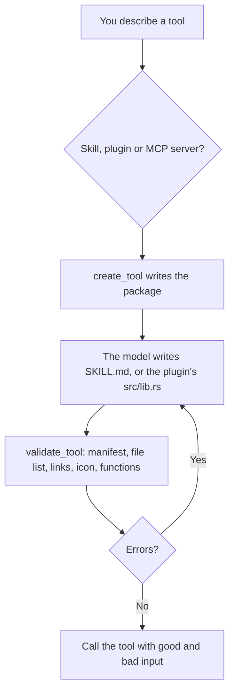

# Tool Creator

Creates new Cluaiz tools (skills, WebAssembly plugins and MCP server packages). It first works out what the tool must do and checks that no existing tool does it already, then writes a correct `package.json`, `SKILL.md`, `README.md` and icon, registers the tool in `family.json` when you work in the cluaiz-tools repository, checks the package for the problems that stop it from installing or working, tests it with good and bad input, and can publish it as a pull request.

## How it works



## Functions

| Function | What it does |
|---|---|
| `create_tool` | Writes a new package to the Engine's tools folder (and to the cluaiz-tools repository and its `family.json` when that is the open folder). Plugins get a Rust WebAssembly starter; MCP packages get `execution` from `command` and `args`. An existing tool is replaced only with `overwrite: true`. |
| `validate_tool` | Checks a package by `tool_id` or `path`: required fields, `id` against the folder and `family.json`, every file listed in `versions.<latest>.files` (the installer copies only those), `SKILL.md` front matter and length, relative links, readable file types, the icon, trigger format, function schemas, the `execution` script, Python syntax, hype words. Returns errors and warnings and changes nothing. |

## Files

| File | Read when |
|---|---|
| [references/skill-authoring.md](references/skill-authoring.md) | Writing a skill, with or without functions |
| [references/wasm-plugin-authoring.md](references/wasm-plugin-authoring.md) | Writing a WebAssembly plugin: the ABI, host imports, manifest |
| [references/mcp-server-authoring.md](references/mcp-server-authoring.md) | Packaging an MCP server |
| [references/workflow-and-flow-authoring.md](references/workflow-and-flow-authoring.md) | A `/command` workflow or an automation flow instead of a tool |
| [references/validation-rubric.md](references/validation-rubric.md) | What a finished tool needs, and what only a real run shows |

## Permissions and dependencies

| Permission | At install | Info |
|---|---|---|
| Files (`files`): `create`, `read`, `update` in the workspace | Not allowed, asked for (sensitive) | Reads a tool package to check it, and creates the files of a new one |

While a permission is refused, the Engine asks before each call. The tool runs as a normal program, so the Engine cannot block that access itself.

Allow or refuse them with `cluaiz skill permission tool-creator [<permission> on|off]`, the App's tool page, or `tools.set_settings`. In `strict` mode every permission is asked for at install.

No dependencies.

## Install

```bash
cluaiz skill install tool-creator
```

Needs Python 3. Building a plugin needs Rust with the `wasm32-unknown-unknown` target.

## Example prompts

- "Make a plugin that counts words in a text."
- "Package the Postgres MCP server as a Cluaiz tool."
- "Check whether skills/my-skill is ready to publish."

## Limits

- `validate_tool` checks structure; it cannot tell whether the instructions are good. Test the tool with a model.
- A plugin does nothing until its `.wasm` is built and copied into the installed folder.
