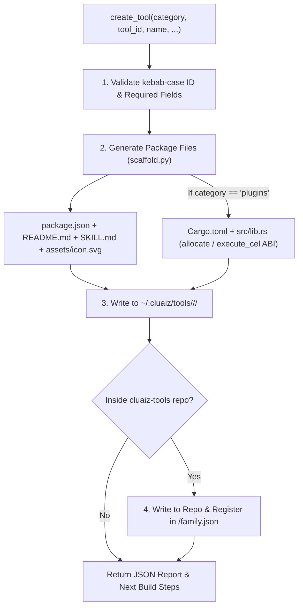

# Autonomous Tool Creator

Scaffolds new Cluaiz Skills, WebAssembly Plugins, and MCP Server packages with validated manifests (`package.json`), human-facing documentation (`README.md`), AI instructions (`SKILL.md`), SVG icons (`assets/icon.svg`), and Rust WebAssembly templates (`Cargo.toml`, `src/lib.rs`).

## Technical Specification

- **Purpose:** Automates creation of compliant Cluaiz tools both in the user's local installation (`~/.cluaiz/tools/`) and, when run inside the `cluaiz-tools` repository, directly registers the package in `<category>/family.json`.
- **Package Type:** Executable Skill (`script_runner` backed by `scripts/scaffold.py`)
- **Platform Support:** Cross-platform (Windows, macOS, Linux)
- **Runtime Dependencies:** Python 3 (`{python}`); Rust (`wasm32-unknown-unknown` target) required when compiling WebAssembly plugins.

## System Architecture & Scaffolding Flow



## API Contract

### Function: `create_tool`

| Parameter | Type | Required | Description |
|---|---|---|---|
| `category` | `string` | Yes | `"skills"`, `"plugins"`, or `"mcp"`. |
| `tool_id` | `string` | Yes | Lowercase kebab-case identifier (e.g., `"word-count"`). Must match folder name and `family.json` key. |
| `name` | `string` | Yes | Human-readable display title. |
| `description` | `string` | Yes | Clear description of what the tool does and when the model should load it. |
| `triggers` | `array<string>` | No | Semantic trigger phrases used by the Cluaiz matcher. |
| `command` | `string` | For `mcp` | Executable that starts the MCP server (e.g., `"npx"` or `"uvx"`). |
| `args` | `array<string>` | For `mcp` | Command-line arguments passed to the MCP server executable. |
| `skill_instructions` | `string` | No | Custom Markdown instructions written to `SKILL.md`. |
| `overwrite` | `boolean` | No | Set to `true` to replace an existing tool directory (defaults to `false`). |

## Generated Package Structure

```text
<category>/<tool_id>/
├── package.json       # Validated manifest with triggers, functions/execution, and files map
├── README.md          # Human & website documentation with Mermaid architecture diagram
├── SKILL.md           # Concise operational instructions for the AI model
├── assets/
│   └── icon.svg       # Standalone 24x24 SVG icon
├── Cargo.toml         # (Plugins only) cdylib crate configured for wasm32-unknown-unknown
└── src/
    └── lib.rs         # (Plugins only) Exported allocate() and execute_cel() entrypoints
```

## Failure & Recovery Logic

- **Overwrite Protection:** Refuses to overwrite an existing `<tool_id>/package.json` unless `overwrite: true` is explicitly passed after user confirmation.
- **Invalid Identifiers:** Rejects `tool_id` values that do not match `^[a-z0-9]+(-[a-z0-9]+)*$` before touching the filesystem.

## Installation & Usage

```bash
cluaiz skill install tool-creator
```

Example prompt:

```text
Create a new WebAssembly plugin called word-count that counts words and lines in a text string.
```

