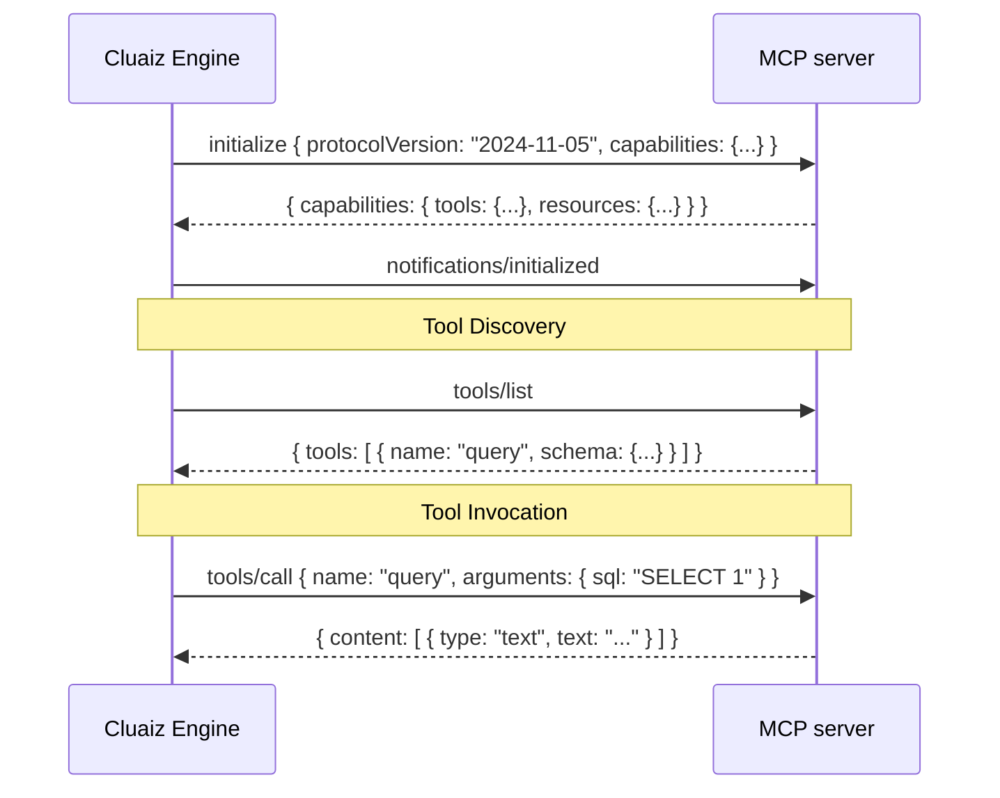

# Writing an MCP server for Cluaiz

Model Context Protocol (MCP) servers allow Cluaiz agents to communicate with external databases, browser drivers, APIs, and host utilities via JSON-RPC over `stdio`.

## 1. When to Choose MCP

Choose an MCP package when your tool needs:
1. **Direct Filesystem or Database Access:** Interacting with SQLite, PostgreSQL, Redis, or local disk directories.
2. **External Binaries or Languages:** Running Node.js, Python, Puppeteer, or Docker commands.
3. **Complex State Management:** Long-running daemon processes or persistent connection pools.

## 2. MCP Manifest (`package.json`)

The Engine starts the server from `execution`. Triggers are a **plain list** for MCP packages; `triggers.semantic` has no effect here. Values in `execution.env` are literal (`${NAME}` is not expanded); settings the user provides, such as a connection string or key, go in the top-level `env` with `info` and `need`. The server gets each as an environment variable, from the system environment or from `cluaiz mcp config <id> <NAME> <value>`.

```json
{
  "id": "postgres-explorer",
  "name": "PostgreSQL Explorer",
  "category": "mcp",
  "hub_type": "mcp",
  "icon": "assets/icon.svg",
  "description": "Reads PostgreSQL schemas and runs read-only queries. Use when the user asks about tables or data in their Postgres database. Needs Node.",
  "license": "MIT",
  "tags": ["Database", "PostgreSQL"],
  "triggers": ["query postgres", "database schema", "list tables"],
  "env": { "DATABASE_URL": { "info": "The connection string of your PostgreSQL database", "need": "required" } },
  "execution": { "command": "npx", "args": ["-y", "@modelcontextprotocol/server-postgres@0.6.2"] },
  "dependencies": { "plugins": {}, "mcp": {}, "skills": {} },
  "latest_version": "1.0.0",
  "versions": {
    "1.0.0": {
      "updated_at": "2026-11-11T09:00:00Z",
      "files": { "readme": "README.md", "skill": "SKILL.md", "icon": "assets/icon.svg" }
    }
  }
}
```

- Pin the package version in `args` (`@0.6.2`), so an update upstream does not change the tool unseen.
- `expose` can limit which of the server's tools the model gets, and which inputs it may set: `{"query": ["sql"]}`.
- There is no `functions` list: the Engine asks the server (`tools/list`).
- `SKILL.md` tells the model when to use the server and what to watch for (for example: read-only, ask before writes).

## 3. Communication & Transport (`stdio`)

The Cluaiz engine spawns the MCP process as a child process and communicates via `stdin` and `stdout`:



## 4. Human-Facing Documentation (`README.md`)

Every MCP server package must include a detailed `README.md` for human users:
- **Prerequisites:** What binary must be installed on the host (e.g., `node >= 18.0`, `python >= 3.10`, `docker`).
- **Configuration Keys:** Explanation of all required environment variables.
- **Safety & Permissions:** Clear notice of whether the server performs write operations or network requests.
- **Mermaid Architecture Diagram:** Visual depiction of the process boundary between Cluaiz and the external daemon.
