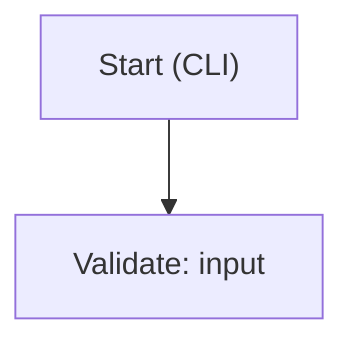

# What a finished tool needs

`validate_tool` checks most of this automatically; the rest needs a real run.

## Checked by `validate_tool`

| Check | Why |
|---|---|
| `package.json` has `id`, `name`, `category`, `hub_type`, `description`, `license`, `latest_version`, `versions` | The Engine, the App and the registry read them |
| `id` equals the folder name and the key in `family.json` | The installer finds the tool by it |
| Every file on disk is in `versions.<latest>.files`, and every listed file exists | Without a release zip, only listed files are installed |
| `README.md` exists, with a Mermaid diagram | People and the website read it |
| `SKILL.md` exists, with front matter; for a skill, `name` equals `id`; `description` is 1 to 1024 characters and says when to use the tool | The model reads it; the matcher uses the description |
| Links in `SKILL.md` and `README.md` are relative and point to files that exist | An absolute path works only on the author's computer |
| `SKILL.md` has no Mermaid diagram and stays short | Each line costs the model tokens |
| Linked files are ones `read_tool_file` can read (`.md`, `.json`, `.yaml`, `.py`, `.js`, `.ts`, `.sh`, `.ps1`, `.rs`, ...) | Other types cannot be shown to the model |
| `assets/icon.svg` is an SVG with a 24 by 24 viewBox, at most 50 KB | The App and the website show it |
| Skills use `triggers.semantic`; plugins and MCP servers a plain `triggers` list | The other form has no effect |
| Each function has a name, a description and an object schema; a skill with functions has `execution`, and its script exists | Otherwise the call cannot run |
| Python scripts compile | A syntax error shows only at the first call |
| Hype words | Say what the tool does and what was measured |

## Checked by running it

1. Call each function once with good input and once with bad input. Bad input gives `{"status": "error", "message": "..."}`, not a crash or a traceback.
2. For a skill, ask the model a question the skill should answer, and check that it reads the skill and follows it.
3. For a skill, run two or three real tasks with and without it, on a small and a large model: fix what the small one gets wrong, cut what the large one did not need.
4. A flow file: `cluaiz flow validate <file>`.
5. A plugin: build it, copy the `.wasm` into the installed folder, call it.

Report what was run and the result, and what was not tested.

## Mermaid labels

Quote node labels that contain brackets, parentheses or colons, or the diagram does not render:

