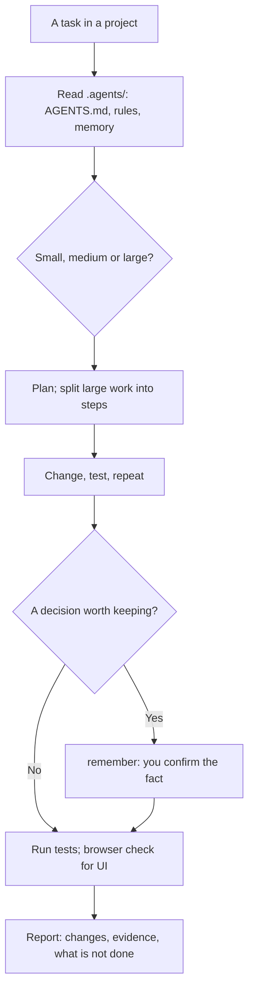

# Workflow Management

How the model should run a project with the Cluaiz terminal agent so the work survives the conversation: read the project's `.agents/` folder first, size the task before starting, save agreed decisions as project memory (with your confirmation), turn repeat tasks into `/workflows` and unattended ones into automation flows, look at UI changes in a browser, and report only what was run and verified.

## How it works



## Function

| Function | What it does |
|---|---|
| `create_workflow` | Writes `.agents/workflows/<name>.md` from a name, a description and steps, so you can run it as `/<name>`. It lists the test and build commands it finds in the project (package.json, Cargo.toml, go.mod, pytest, Makefile), refuses names of the agent's own commands such as `/init`, and changes an existing workflow only when asked. |

## Files

| File | Read when |
|---|---|
| [references/workspace-anatomy.md](references/workspace-anatomy.md) | The `.agents/` layout, rule triggers, which `AGENTS.md` wins, `/init` |
| [references/memory-journaling.md](references/memory-journaling.md) | Saving and correcting project facts with `remember` and `forget` |

## Install

```bash
cluaiz skill install workflow-management
```

Works best in `cluaiz agent`, which has the `remember` and `forget` tools and runs `/workflows`. In a project without instructions, type `/init` in the agent to create `.agents/AGENTS.md`. For browser checks: `cluaiz mcp install browser`.

## Example prompts

- "Set this project up for the agent."
- "Plan the login screen before you start."
- "Remember that tests run with npm run check."
- "Make a /release workflow for this repo."

## Limits

- Nothing is saved to memory without your yes.
- Flows cannot run programs; builds and tests belong in workflows.
- The browser tools cannot resize the window; phone-width checks are done in your browser's device mode or by reading the CSS.
